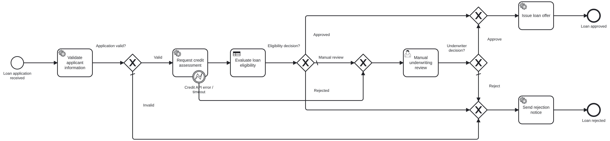

# Lab 1 – End-to-End Loan Approval Automation

Loan applications are validated by a Spring Boot job worker, checked against a (mock) credit bureau through a REST Connector, classified by a DMN decision table as **Approved / Rejected / Manual Review**, and – where needed – reviewed by an underwriter in Tasklist. Operate is used to monitor instances and to recover from an intentional worker failure.



| Artifact | File |
|---|---|
| BPMN process `loan-approval-process` | [models/loan-approval.bpmn](models/loan-approval.bpmn) |
| DMN decision `loan-eligibility` | [models/loan-eligibility.dmn](models/loan-eligibility.dmn) – rules: [docs/dmn-rules.md](docs/dmn-rules.md) |
| Start form / review form | [models/loan-application-start.form](models/loan-application-start.form), [models/loan-manual-review.form](models/loan-manual-review.form) |
| Job workers | [LoanWorkers.java](src/main/java/edu/srmist/camunda/loan/worker/LoanWorkers.java) + logic in [logic/](src/main/java/edu/srmist/camunda/loan/logic) |
| REST Connector + API examples | [api-examples/](api-examples) |
| Variables | [docs/process-variables.md](docs/process-variables.md) |
| Test cases | [docs/test-cases.md](docs/test-cases.md), inputs in [test-data/](test-data) |
| Report | [docs/REPORT.md](docs/REPORT.md) |

## Flow

1. **Loan application received** – start event with a Camunda Form (or start via REST).
2. **Validate applicant information** – job worker `loan.validate-application` checks the fields and computes `proposedEmi`, `dtiRatio`, `loanToIncomeRatio`. Invalid → *Send rejection notice*.
3. **Request credit assessment** – REST Connector `POST /credit-bureau/api/v1/assessments`. Any HTTP error or timeout → BPMN error `CREDIT_API_ERROR` → boundary event → manual review.
4. **Evaluate loan eligibility** – business rule task calls DMN `loan-eligibility` → `eligibility = {decision, reason, riskBand}`.
5. **Eligibility decision?** – APPROVED → *Issue loan offer*; REJECTED → *Send rejection notice*; otherwise → **Manual underwriting review** (Tasklist, candidate group `underwriters`).
6. **Underwriter decision?** – APPROVE → offer, REJECT → rejection notice.
7. Workers `loan.issue-offer` / `loan.send-rejection` set `finalOutcome` and simulate the customer notification.

## Run

Prerequisites and Camunda set-up: [../docs/SETUP.md](../docs/SETUP.md).

```bash
mvn -pl mock-services spring-boot:run          # terminal 1 (port 8090)
mvn -pl lab1-loan-approval spring-boot:run     # terminal 2 (port 8091) – deploys BPMN, DMN, forms
./lab1-loan-approval/scripts/run-scenarios.sh  # terminal 3 – starts scenarios, prints results
```

Configuration: [src/main/resources/application.yaml](src/main/resources/application.yaml) (Camunda addresses, auth, mock base URL).

## Executing the test scenarios

| # | Scenario file | What to do |
|---|---|---|
| 01 | `01-approved` | nothing – completes automatically → APPROVED |
| 02 | `02-rejected-eligibility` | nothing – DMN rejects (score 520) → REJECTED |
| 03 | `03-manual-review` | Tasklist → *Manual underwriting review* for LA-1003 → **Approve**, fill name and comment → APPROVED |
| 04a | `04a-credit-api-timeout` | bureau does not answer in 5 s → caught → Tasklist task shows *Credit check status FAILED* → **Reject** → REJECTED |
| 04b | `04b-credit-api-error` | bureau returns HTTP 500 → caught → Tasklist → **Reject** → REJECTED |
| 05 | `05-worker-failure-recovery` | incident – follow the recovery steps below → APPROVED |
| 06 | `06-invalid-application` | nothing – validation fails (age 19, amount > 50 lakh) → REJECTED |

After completing the tasks, get the final table: `curl http://localhost:8091/api/scenarios/results.md` and paste it into [docs/test-cases.md](docs/test-cases.md).

### Worker failure → diagnosis → correction → retry (scenario 05)

1. Start it (`./scripts/run-scenarios.sh 05-worker-failure-recovery` or via start-all). `monthlyIncome` is sent as the text `"45k"`.
2. The worker `loan.validate-application` cannot parse it and fails the job with **0 retries** (bad data will not fix itself), so Zeebe raises an **incident** immediately. Worker log: `data contract violation: Process variable 'monthlyIncome' must be numeric but was '45k'`.
3. **Operate → Processes → Loan Approval Process** → the instance has a red incident marker on *Validate applicant information*. Open the instance → *Incidents* banner: type *Job: No retries left*, message (first line of the worker's stack trace) *io.camunda.client.exception.JobError: Validation worker cannot process the application: Process variable 'monthlyIncome' must be numeric but was '45k'. Fix the variable in Operate and retry.*
4. **Correct the cause**: in the *Variables* panel edit `monthlyIncome` → `45000` → save.
5. Click **Retry** on the incident. The job is re-activated, validation succeeds, the bureau returns score 750 for `SYN-1005`, the DMN approves, and the instance completes with `finalOutcome = APPROVED`.

Optional: switch the whole bureau off (`PUT http://localhost:8090/admin/faults/credit?mode=DOWN`) to see every application routed to manual review, then back `UP`.

## Tests

`mvn -pl lab-common,lab1-loan-approval verify` – unit tests for validation, EMI/ratio maths, offer/rejection logic ([LoanLogicTest](src/test/java/edu/srmist/camunda/loan/LoanLogicTest.java)). The DMN table is evaluated against [models/dmn-tests/loan-eligibility-cases.json](models/dmn-tests/loan-eligibility-cases.json) (results in [docs/dmn-rules.md](docs/dmn-rules.md)).
