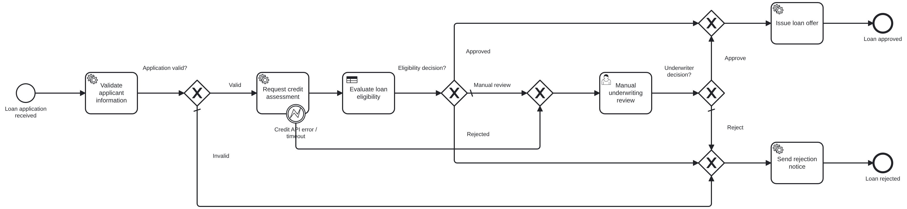

# Lab 1 – End-to-End Loan Approval Automation: Implementation Report

## 1. Objective

Automate a loan application from submission to decision with Camunda 8: BPMN orchestration, a DMN eligibility decision, an external Java job worker, a REST integration with a credit-assessment service, a human review step in Tasklist, and monitoring plus incident recovery in Operate.

## 2. Architecture

| Component | Technology | Responsibility |
|---|---|---|
| Process `loan-approval-process` | BPMN 2.0 on Zeebe (Camunda 8.8) | orchestration, routing, error handling |
| Decision `loan-eligibility` | DMN 1.3 decision table, hit policy FIRST | APPROVED / REJECTED / MANUAL_REVIEW |
| Worker app `lab1-loan-approval` (:8091) | Java 17, Spring Boot 3.5, `camunda-spring-boot-starter` 8.8 | job workers `loan.validate-application`, `loan.issue-offer`, `loan.send-rejection`; deploys the models; scenario API |
| REST Connector | `io.camunda:http-json:1` (template `HttpJson.v2`) | `POST /credit-bureau/api/v1/assessments` |
| Mock credit bureau (:8090) | Spring Boot (`mock-services`) | synthetic bureau records, simulated timeout / HTTP 500 / outage |
| Tasklist | Camunda user task + Camunda Form `loan-manual-review` | underwriter decision |
| Operate | – | monitoring, variables, incidents, retry |

Interaction: the worker app opens long-polling job subscriptions to Zeebe; Zeebe creates a job whenever a service task with the matching type is reached; the worker returns variables which Zeebe merges into the instance. The REST Connector job is executed by the Connectors runtime bundled with Camunda 8 Run, which calls the mock bureau over HTTP.

## 3. Implementation

**BPMN.** Start event (with start form) → *Validate applicant information* (service task) → XOR *Application valid?* → *Request credit assessment* (REST Connector) with an interrupting **error boundary event** for `CREDIT_API_ERROR` → *Evaluate loan eligibility* (business rule task, `zeebe:calledDecision`, result `eligibility`) → XOR *Eligibility decision?* → three paths: offer, rejection, or the *Manual underwriting review* user task (candidate group `underwriters`, form `loan-manual-review`) followed by XOR *Underwriter decision?*. Merge gateways lead to *Issue loan offer* / *Send rejection notice* and the end events *Loan approved* / *Loan rejected*. Every XOR gateway has a default flow so no token can get stuck.

**DMN.** Five inputs (credit score, defaults in 24 months, debt-to-income ratio, loan/annual income, employment type), three outputs (decision, reason, risk band), eight rules with hit policy FIRST: five knock-out rules, one straight-through approval rule, two referral rules (the last a catch-all). Rules and sample evaluations: [dmn-rules.md](dmn-rules.md).

**Job worker.** [`LoanWorkers`](../src/main/java/edu/srmist/camunda/loan/worker/LoanWorkers.java) uses `@JobWorker` methods returning a `Map` of output variables (auto-complete). Business logic lives in plain classes that are unit-tested:
* [`LoanApplicationValidator`](../src/main/java/edu/srmist/camunda/loan/logic/LoanApplicationValidator.java) – field rules (synthetic id patterns, age 21–65, amount 10,000–50,00,000, term 6–84) and affordability (`proposedEmi` at an assumed 12 % p.a., `dtiRatio`, `loanToIncomeRatio`). Business-rule violations return `validationStatus = INVALID`; a **data-contract violation** (e.g. non-numeric income) fails the job with zero retries so an incident is raised immediately.
* [`LoanOutcomes`](../src/main/java/edu/srmist/camunda/loan/logic/LoanOutcomes.java) – offer (rate by risk band, EMI, validity) and rejection notice with reasons.

**REST integration.** The connector builds the request body from process variables, maps the response with a result expression (`creditScore`, `riskGrade`, `defaultsLast24Months`, …) and uses an **error expression** that converts any failure – HTTP error, connection refused or the 5 s read timeout – into BPMN error `CREDIT_API_ERROR`. The boundary event's output mapping sets `creditCheckStatus = "FAILED"`; the application then goes to an underwriter rather than failing. Details: [../api-examples](../api-examples).

**Process variables.** Full dictionary with types and the element that writes each variable: [process-variables.md](process-variables.md).

**Deployment.** `@Deployment(resources = {"classpath*:/models/*.bpmn", "*.dmn", "*.form"})` deploys BPMN, DMN and both forms on start-up (they can also be deployed from Desktop Modeler).

## 4. Test execution and results

Scenarios ([test-cases.md](test-cases.md)) cover all five required cases plus an invalid application:

| Required scenario | Scenario | Expected |
|---|---|---|
| meets approval criteria | 01 | APPROVED automatically (DMN rule 6) |
| fails eligibility | 02 | REJECTED (rule 2, score 520) |
| requires manual review | 03 | MANUAL_REVIEW (rule 7) → underwriter approves → APPROVED |
| credit API error / timeout | 04a (timeout), 04b (HTTP 500) | boundary error → underwriter → REJECTED |
| worker failure + recovery | 05 | incident → fix variable in Operate → retry → APPROVED |

The lab app's `GET /api/scenarios/results.md` endpoint builds the actual-vs-expected table from live engine data (instance state, incidents, active element, `finalOutcome`). The executed table and screenshots are in [test-cases.md](test-cases.md) and [screenshots/](screenshots).

Static verification performed on the models: BPMN linted with the camunda-compat 8.8 rule set (0 findings, FEEL syntax included); DMN evaluated against 12 cases (12/12 as expected, including the 720/0.40/3.0 boundaries); forms validated against the Camunda Forms schema; worker logic covered by 8 JUnit tests.

## 5. Monitoring and incident recovery

1. Scenario 05 sends `monthlyIncome = "45k"`.
2. The validation worker raises a job failure with 0 retries → Operate shows an **incident** on *Validate applicant information* ("Job: No retries left") with the message *Process variable 'monthlyIncome' must be numeric but was '45k'* (screenshot `13-operate-incident.png`).
3. **Diagnosis**: the message identifies the variable; the Variables panel shows the string value.
4. **Correction**: edit `monthlyIncome` to `45000` (`14-operate-fix-variable.png`).
5. **Retry** the incident: the job is re-activated, validation succeeds and the instance completes as APPROVED (`15-operate-incident-resolved.png`).

Design choice: data errors fail fast (retries = 0) because retrying the same bad data is pointless; technical errors from the bureau are handled in the model (error boundary) so the business can still decide manually.

## 6. Assumptions

* All applicants, ids and amounts are synthetic; applicant ids must match `SYN-0000`, emails use `example.com`.
* Eligibility thresholds and the 12 % affordability rate are educational values, not lending policy.
* The credit bureau is simulated; records exist for `SYN-1001`–`SYN-1006`, other ids return "no history" (score 600).
* Notifications are simulated (logged and stored as `notificationStatus`).

## 7. Limitations

* No authentication between the worker and Camunda (Camunda 8 Run's API is unprotected by default); production would use OIDC client credentials and connector secrets.
* Mock-service state (bureau records) is in memory.
* The underwriter task has no SLA timer/escalation; a timer boundary event would be the next step.
* A credit API error goes straight to manual review without automatic retries of the call; a retry policy (e.g. `job.retries` in the error expression) could be added before falling back.
