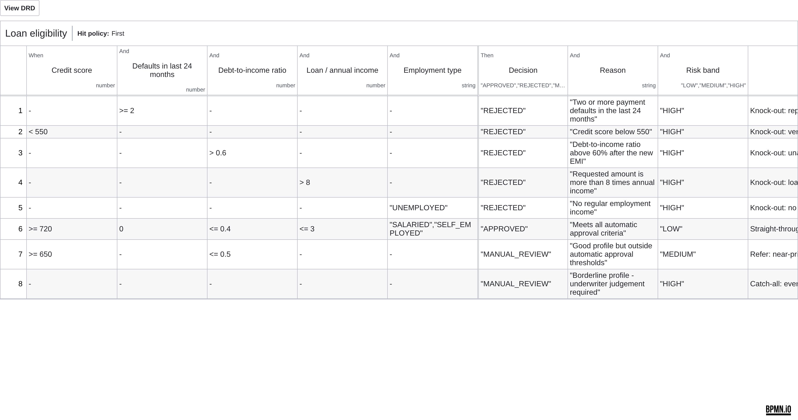

# Lab 1 – DMN decision table `loan-eligibility`

File: [../models/loan-eligibility.dmn](../models/loan-eligibility.dmn). Called by the business rule task *Evaluate loan eligibility*; result stored in `eligibility`.

> Educational rules for a classroom scenario – not real lending policy.

## Inputs and outputs

| | Label | Expression / name | Type |
|---|---|---|---|
| Input | Credit score | `creditScore` | number |
| Input | Defaults in last 24 months | `defaultsLast24Months` | number |
| Input | Debt-to-income ratio | `dtiRatio` | number |
| Input | Loan / annual income | `loanToIncomeRatio` | number |
| Input | Employment type | `employmentType` | string |
| Output | Decision | `decision` | string: APPROVED, REJECTED, MANUAL_REVIEW |
| Output | Reason | `reason` | string |
| Output | Risk band | `riskBand` | string: LOW, MEDIUM, HIGH |

## Rules (hit policy FIRST – evaluated top-down, first match wins)

| # | Condition | Decision | Risk band | Rationale |
|---|---|---|---|---|
| 1 | defaults in last 24 months ≥ 2 | REJECTED | HIGH | repeated defaults are a knock-out |
| 2 | credit score < 550 | REJECTED | HIGH | very low score |
| 3 | DTI > 0.60 | REJECTED | HIGH | repayments would exceed 60 % of income |
| 4 | loan / annual income > 8 | REJECTED | HIGH | loan far too large for income |
| 5 | employment = UNEMPLOYED | REJECTED | HIGH | no regular income |
| 6 | score ≥ 720 **and** no defaults **and** DTI ≤ 0.40 **and** loan/income ≤ 3 **and** salaried/self-employed | APPROVED | LOW | straight-through approval |
| 7 | score ≥ 650 **and** DTI ≤ 0.50 | MANUAL_REVIEW | MEDIUM | near-prime: underwriter decides |
| 8 | anything else | MANUAL_REVIEW | HIGH | catch-all: never auto-approve an unclear case |

Why FIRST: knock-out rules must win over approval rules, and the catch-all guarantees every application gets exactly one outcome (no "no rule matched" gaps).

## Sample evaluations

Evaluated with a FEEL interpreter against [../models/dmn-tests/loan-eligibility-cases.json](../models/dmn-tests/loan-eligibility-cases.json) – 12/12 as expected. The same results appear in Operate → *Decisions* for the running instances.

| Case | Credit score | Defaults in last 24 months | Debt-to-income ratio | Loan / annual income | Employment type | Matched rule | Decision | Reason | Risk band | Expected | Result |
|---|---|---|---|---|---|---|---|---|---|---|---|
| S01 strong salaried applicant | 780 | 0 | 0.18 | 0.35 | "SALARIED" | R6 | APPROVED | Meets all automatic approval criteria | LOW | APPROVED | PASS |
| S02 credit score 520 | 520 | 1 | 0.25 | 0.5 | "SALARIED" | R2 | REJECTED | Credit score below 550 | HIGH | REJECTED / Credit score below 550 | PASS |
| S03 near-prime 690, DTI 0.43 | 690 | 0 | 0.43 | 1.11 | "SALARIED" | R7 | MANUAL_REVIEW | Good profile but outside automatic approval thresholds | MEDIUM | MANUAL_REVIEW / MEDIUM | PASS |
| Two defaults | 640 | 2 | 0.3 | 1 | "SALARIED" | R1 | REJECTED | Two or more payment defaults in the last 24 months | HIGH | REJECTED / HIGH | PASS |
| DTI 0.65 | 760 | 0 | 0.65 | 1 | "SALARIED" | R3 | REJECTED | Debt-to-income ratio above 60% after the new EMI | HIGH | REJECTED | PASS |
| Loan 9x income | 760 | 0 | 0.3 | 9 | "SALARIED" | R4 | REJECTED | Requested amount is more than 8 times annual income | HIGH | REJECTED | PASS |
| Unemployed | 700 | 0 | 0.3 | 1 | "UNEMPLOYED" | R5 | REJECTED | No regular employment income | HIGH | REJECTED / No regular employment income | PASS |
| No bureau history (score 600) | 600 | 0 | 0.3 | 1 | "SALARIED" | R8 | MANUAL_REVIEW | Borderline profile - underwriter judgement required | HIGH | MANUAL_REVIEW / HIGH | PASS |
| Self-employed strong profile | 735 | 0 | 0.35 | 2.5 | "SELF_EMPLOYED" | R6 | APPROVED | Meets all automatic approval criteria | LOW | APPROVED | PASS |
| Boundary: exactly 720 / 0.40 / 3.0 | 720 | 0 | 0.4 | 3 | "SALARIED" | R6 | APPROVED | Meets all automatic approval criteria | LOW | APPROVED | PASS |
| Boundary: score 719 | 719 | 0 | 0.4 | 3 | "SALARIED" | R7 | MANUAL_REVIEW | Good profile but outside automatic approval thresholds | MEDIUM | MANUAL_REVIEW / MEDIUM | PASS |
| S05 after Operate fix (income 45000) | 750 | 0 | 0.27 | 0.56 | "SALARIED" | R6 | APPROVED | Meets all automatic approval criteria | LOW | APPROVED | PASS |
