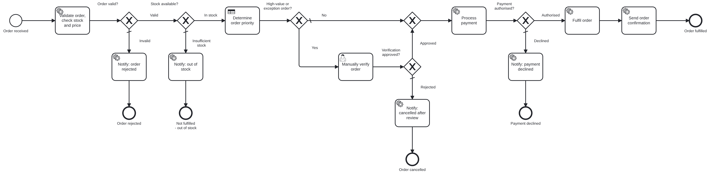

# Lab 2 – End-to-End E-Commerce Order Processing and Fulfilment

An order is validated, checked against a simulated inventory and priced by a Spring Boot job worker; a DMN table sets its priority; high-value or exception orders are verified by a person in Tasklist; payment goes through a mock payment gateway via a REST Connector; the order is then fulfilled or closed with a customer notification. Operate is used to monitor and to recover from a payment-service outage.



| Artifact | File |
|---|---|
| BPMN process `order-processing-process` | [models/order-processing.bpmn](models/order-processing.bpmn) |
| DMN decision `order-priority` | [models/order-priority.dmn](models/order-priority.dmn) – rules: [docs/dmn-rules.md](docs/dmn-rules.md) |
| Forms | [order-placement.form](models/order-placement.form) (start), [order-manual-verification.form](models/order-manual-verification.form) |
| Job workers | [OrderWorkers.java](src/main/java/edu/srmist/camunda/order/worker/OrderWorkers.java) + [logic/](src/main/java/edu/srmist/camunda/order/logic) |
| REST Connector + API examples | [api-examples/](api-examples) |
| Variables + routing | [docs/process-variables.md](docs/process-variables.md) |
| Test cases | [docs/test-cases.md](docs/test-cases.md), inputs in [test-data/](test-data) |
| Report | [docs/REPORT.md](docs/REPORT.md) |

## Flow

1. **Order received** (start form or REST) – `orderId`, `customerRef`, `customerCategory`, `productId`, `quantity`, `deliveryPreference`, `paymentToken` (mock token, never a card number).
2. **Validate order, check stock and price** – worker `order.validate-and-price`: validation, simulated inventory lookup, subtotal + 18 % GST + delivery fee = `orderTotal`.
3. **Order valid?** / **Stock available?** – invalid → *Notify: order rejected*; insufficient stock → *Notify: out of stock*.
4. **Determine order priority** – DMN `order-priority` → `priorityDecision = {priority, fulfilmentSlaHours, reason}`.
5. **High-value or exception order?** – `orderTotal ≥ 1,00,000` **or** (`customerCategory = NEW` **and** `orderTotal ≥ 25,000`) → **Manually verify order** (Tasklist, group `order-verification`); rejected → *Notify: cancelled after review*.
6. **Process payment** – REST Connector `POST /payments/api/v1/charges` with `Idempotency-Key = orderId`.
7. **Payment authorised?** – yes → **Fulfil order** (worker `order.fulfil`: reserve stock, warehouse, dispatch deadline from the SLA) → *Send order confirmation*; no → *Notify: payment declined*.

All notification tasks use one worker (`order.notify-customer`); the BPMN input mapping `notificationType` tells it which message to send, and it sets `finalOutcome`.

## Run

```bash
mvn -pl mock-services spring-boot:run              # :8090
mvn -pl lab2-order-processing spring-boot:run      # :8092 – deploys BPMN, DMN, forms
./lab2-order-processing/scripts/run-scenarios.sh   # starts automatic scenarios, prints results
```

## Executing the test scenarios

| # | Scenario | What to do |
|---|---|---|
| 01 | `01-in-stock-payment-success` | automatic → FULFILLED |
| 02 | `02-insufficient-stock` | automatic → OUT_OF_STOCK |
| 03 | `03-payment-declined` | automatic → PAYMENT_DECLINED |
| 04 | `04-high-value-manual-review` | Tasklist → *Manually verify order* ORD-2004 → **Approve** → FULFILLED |
| 05 | `05-payment-service-outage-recovery` | manual start – see below → FULFILLED |
| 06 | `06-invalid-order` | automatic → REJECTED_INVALID (quantity 0, the public test card number 4111… is refused) |
| 07 | `07-new-customer-review-rejected` | Tasklist → ORD-2007 → **Reject** → CANCELLED_AFTER_REVIEW |
| 08 | `08-inventory-outage-recovery` | optional alternative failure (worker dependency) |

Results: `curl http://localhost:8092/api/scenarios/results.md`.

### Payment-service failure → incident → recovery (scenario 05)

```bash
./lab2-order-processing/scripts/fault.sh down          # payment mock returns HTTP 503
./lab2-order-processing/scripts/run-scenarios.sh 05-payment-service-outage-recovery
```

1. *Process payment* fails with HTTP 503. The connector retries 3 times with a 10 s back-off (`retryBackoff = PT10S`); after the last attempt Zeebe raises an **incident** (~30 s).
2. **Operate** → Order Processing → instance ORD-2005 → incident on *Process payment*; the message contains the 503 *Service Unavailable* error. Variables show the order is otherwise complete (`orderTotal`, `priorityDecision` = CRITICAL).
3. **Fix the cause**: `./lab2-order-processing/scripts/fault.sh up`.
4. **Retry** the incident in Operate. The charge succeeds (`paymentStatus = AUTHORISED`), the order is fulfilled → `finalOutcome = FULFILLED`. Because of the idempotency key the customer can never be charged twice by retries.

Alternative (scenario 08): `curl -X PUT "http://localhost:8092/admin/worker-faults/inventory?mode=DOWN"` makes the *validation/inventory worker* fail with retries + back-off until an incident is raised; set `mode=UP` and retry.

## Tests

`mvn -pl lab-common,lab2-order-processing verify` – [OrderLogicTest](src/test/java/edu/srmist/camunda/order/OrderLogicTest.java) (pricing, GST, stock, card-number rejection, fulfilment SLA, notifications). DMN cases: [models/dmn-tests/order-priority-cases.json](models/dmn-tests/order-priority-cases.json).
