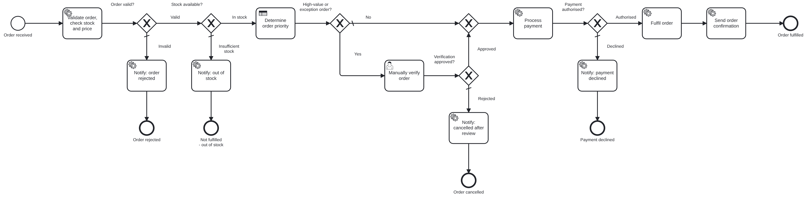

# Lab 2 – E-Commerce Order Processing and Fulfilment: Implementation Report

## 1. Objective

Automate an order from receipt to fulfilment with Camunda 8: validate the order, check stock, determine priority with DMN, verify high-value/exception orders manually, process a simulated payment through a REST Connector, and fulfil or close the order – with monitoring and recovery from a service failure in Operate.

## 2. Architecture

| Component | Technology | Responsibility |
|---|---|---|
| Process `order-processing-process` | BPMN on Zeebe 8.8 | orchestration and routing |
| Decision `order-priority` | DMN decision table, hit policy FIRST | priority + dispatch SLA |
| Worker app `lab2-order-processing` (:8092) | Java 17, Spring Boot 3.5, Camunda Spring Boot starter 8.8 | `order.validate-and-price`, `order.fulfil`, `order.notify-customer`; simulated inventory; deploys models |
| REST Connector | `io.camunda:http-json:1` | `POST /payments/api/v1/charges` |
| Mock payment gateway (:8090) | Spring Boot `mock-services` | token-based authorise/decline, idempotency, outage simulation |
| Tasklist | Camunda user task + form `order-manual-verification` | manual verification |
| Operate | – | monitoring, incident diagnosis, retry |

## 3. Implementation

**BPMN.** *Order received* (start form) → *Validate order, check stock and price* → XOR *Order valid?* → XOR *Stock available?* → *Determine order priority* (business rule task, result `priorityDecision`) → XOR *High-value or exception order?* → (optional) *Manually verify order* + XOR *Verification approved?* → merge → *Process payment* (REST Connector) → XOR *Payment authorised?* → *Fulfil order* → *Send order confirmation* → *Order fulfilled*. Each unsuccessful branch ends in its own notification task and end event (*Order rejected*, *Not fulfilled – out of stock*, *Order cancelled*, *Payment declined*), which makes the outcome visible at a glance in Operate. All notification tasks share the job type `order.notify-customer`; an input mapping sets `notificationType` per task.

**DMN.** Inputs: order value, customer category, delivery preference; outputs: priority, dispatch SLA hours, reason; six rules with hit policy FIRST ([dmn-rules.md](dmn-rules.md)).

**Job worker.** [`OrderWorkers`](../src/main/java/edu/srmist/camunda/order/worker/OrderWorkers.java) with logic in:
* [`OrderValidator`](../src/main/java/edu/srmist/camunda/order/logic/OrderValidator.java) – id formats, category, delivery, quantity 1–20, product exists, **mock token only** (anything resembling a 12–19 digit card number is rejected); price = subtotal + 18 % GST + delivery fee; stock check against [`Inventory`](../src/main/java/edu/srmist/camunda/order/logic/Inventory.java).
* [`OrderOutcomes`](../src/main/java/edu/srmist/camunda/order/logic/OrderOutcomes.java) – stock reservation, warehouse, dispatch deadline from the SLA; customer messages and `finalOutcome`.
* Failure policy: inventory outage → `JobError` with decremented retries and 10 s back-off (transient); bad data → retries 0 (incident immediately).

**REST integration.** Body built from variables (`orderId`, `orderTotal`, `paymentToken`, …), header `Idempotency-Key = orderId`, result expression → `paymentStatus`, `paymentChargeId`, `paymentDeclineReason`. Declines are normal HTTP 200 responses routed by the gateway; technical errors (5xx/timeouts) are retried 3× with `PT10S` back-off and then raise an incident. See [../api-examples](../api-examples).

**Variables and routing.** [process-variables.md](process-variables.md).

## 4. Test execution and results

| Required scenario | Scenario | Expected |
|---|---|---|
| stock available, payment succeeds | 01 | FULFILLED |
| insufficient stock | 02 | OUT_OF_STOCK – payment never attempted |
| payment declined | 03 | PAYMENT_DECLINED |
| high-value order → manual review | 04 (approve), 07 (NEW customer, reject) | FULFILLED / CANCELLED_AFTER_REVIEW |
| payment or inventory failure + recovery | 05 (payment), 08 (inventory) | incident → fix → retry → FULFILLED |

Plus 06 – invalid order (quantity 0, card number instead of a token) → REJECTED_INVALID. The live actual-vs-expected table comes from `GET /api/scenarios/results.md`; executed results and evidence: [test-cases.md](test-cases.md), [screenshots/](screenshots).

Static verification: BPMN lint with camunda-compat 8.8 (0 findings); DMN 9/9 sample cases; forms schema-valid; 6 JUnit tests for pricing, stock, card-number rejection, fulfilment SLA and notifications (expected totals: 5,897.64 for scenario 01 and 2,12,397.64 for scenario 04).

## 5. Monitoring and incident recovery

1. `PUT /admin/faults/payment?mode=DOWN` – the mock gateway answers HTTP 503.
2. Start scenario 05. *Process payment* is retried three times (10 s apart); Operate then shows an **incident** on the task with the 503 error message (`14-operate-payment-incident.png`).
3. Diagnosis: incident message (HTTP 503 Service Unavailable from the payment endpoint), variables show a valid, priced order; the mock-service log confirms the simulated outage.
4. Correction: `PUT /admin/faults/payment?mode=UP`.
5. **Retry** in Operate → AUTHORISED → fulfilled (`16-operate-incident-resolved.png`). The idempotency key guarantees at most one charge per order.

## 6. Assumptions

* Catalogue, stock, customers and tokens are synthetic; stock is held in memory per worker run.
* GST 18 %, delivery fees and the verification thresholds (1,00,000; 25,000 for NEW customers) are educational values.
* The payment gateway is a mock; tokens stand in for tokenised cards.
* Notifications are simulated.

## 7. Limitations

* Stock is reserved at fulfilment time, not at validation, so concurrent orders could still race; a reservation step with compensation would close this gap.
* No refund/compensation path if fulfilment fails after a successful payment.
* The mock gateway's idempotency store is in memory.
* No authentication between worker and Camunda (Camunda 8 Run default).
