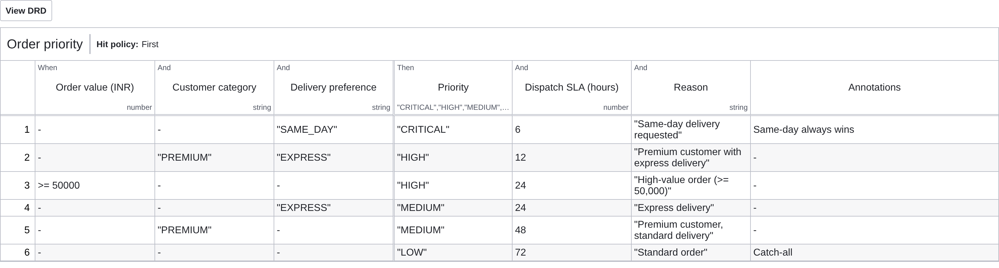

# Lab 2 – DMN decision table `order-priority`

File: [../models/order-priority.dmn](../models/order-priority.dmn). Called by *Determine order priority*; result stored in `priorityDecision`.

## Inputs and outputs

| | Label | Expression / name | Type |
|---|---|---|---|
| Input | Order value (INR) | `orderTotal` | number |
| Input | Customer category | `customerCategory` | string (NEW, REGULAR, PREMIUM) |
| Input | Delivery preference | `deliveryPreference` | string (STANDARD, EXPRESS, SAME_DAY) |
| Output | Priority | `priority` | CRITICAL, HIGH, MEDIUM, LOW |
| Output | Dispatch SLA (hours) | `fulfilmentSlaHours` | number |
| Output | Reason | `reason` | string |

## Rules (hit policy FIRST)

| # | Order value | Customer | Delivery | Priority | SLA | Rationale |
|---|---|---|---|---|---|---|
| 1 | – | – | SAME_DAY | CRITICAL | 6 h | same-day promise always wins |
| 2 | – | PREMIUM | EXPRESS | HIGH | 12 h | premium customer paying for express |
| 3 | ≥ 50,000 | – | – | HIGH | 24 h | high-value orders ship quickly |
| 4 | – | – | EXPRESS | MEDIUM | 24 h | express delivery |
| 5 | – | PREMIUM | – | MEDIUM | 48 h | premium customer, standard delivery |
| 6 | – | – | – | LOW | 72 h | catch-all |

The priority drives the dispatch deadline (`dispatchBy = now + fulfilmentSlaHours`) set by the fulfilment worker. The manual-verification condition is deliberately kept in the gateway (it is a control rule, not a priority) and is documented in [process-variables.md](process-variables.md).

## Sample evaluations

Evaluated with a FEEL interpreter against [../models/dmn-tests/order-priority-cases.json](../models/dmn-tests/order-priority-cases.json) – 9/9 as expected, including the 50,000 boundary.

| Case | Order value (INR) | Customer category | Delivery preference | Matched rule | Priority | Dispatch SLA (hours) | Reason | Expected | Result |
|---|---|---|---|---|---|---|---|---|---|
| S01 regular, standard, 5,897.64 | 5897.64 | "REGULAR" | "STANDARD" | R6 | LOW | 72 | Standard order | LOW / 72 | PASS |
| S03 premium, express | 4867.82 | "PREMIUM" | "EXPRESS" | R2 | HIGH | 12 | Premium customer with express delivery | HIGH / 12 | PASS |
| S04 regular, standard, 2,12,397.64 | 212397.64 | "REGULAR" | "STANDARD" | R3 | HIGH | 24 | High-value order (>= 50,000) | HIGH / 24 | PASS |
| S05 regular, same day | 22717.82 | "REGULAR" | "SAME_DAY" | R1 | CRITICAL | 6 | Same-day delivery requested | CRITICAL / 6 | PASS |
| S07 new customer, 58,998.82 | 58998.82 | "NEW" | "STANDARD" | R3 | HIGH | 24 | High-value order (>= 50,000) | HIGH | PASS |
| Regular, express, low value | 2000 | "REGULAR" | "EXPRESS" | R4 | MEDIUM | 24 | Express delivery | MEDIUM / 24 | PASS |
| Premium, standard, low value | 2000 | "PREMIUM" | "STANDARD" | R5 | MEDIUM | 48 | Premium customer, standard delivery | MEDIUM / 48 | PASS |
| Boundary: exactly 50,000 | 50000 | "NEW" | "STANDARD" | R3 | HIGH | 24 | High-value order (>= 50,000) | HIGH | PASS |
| Boundary: 49,999.99 | 49999.99 | "NEW" | "STANDARD" | R6 | LOW | 72 | Standard order | LOW | PASS |
