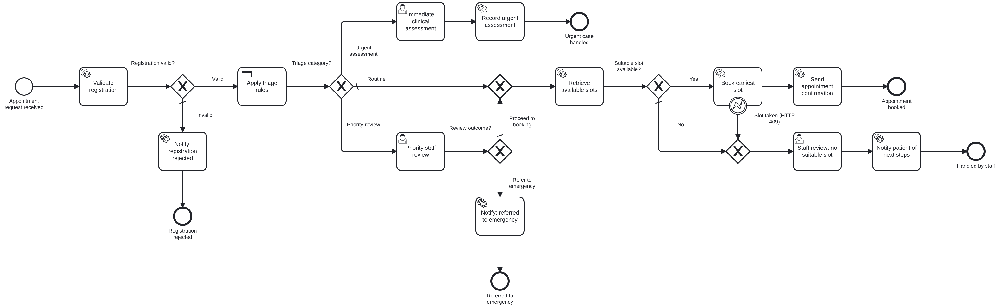

# Lab 3 – End-to-End Hospital Appointment and Patient Triage Management

A (synthetic) patient's appointment request is validated by a Spring Boot job worker, classified by an **educational** DMN triage table as *Routine*, *Priority Review* or *Urgent Assessment*, and routed: urgent cases go straight to a clinician task, priority cases to a staff review, routine cases to a mock scheduling API through two REST Connectors (slot lookup, then booking). If no suitable slot exists, front-desk staff handle it in Tasklist. Operate is used for monitoring and to recover from a scheduling-service outage.

> Synthetic data only (`SYN-PAT-0000` references). The triage rules are for a simulated classroom workflow, not clinical guidance.



| Artifact | File |
|---|---|
| BPMN process `hospital-appointment-process` | [models/hospital-appointment.bpmn](models/hospital-appointment.bpmn) |
| DMN decision `triage-category` | [models/triage-category.dmn](models/triage-category.dmn) – rules: [docs/dmn-rules.md](docs/dmn-rules.md) |
| Forms | [appointment-request](models/appointment-request.form) (start), [urgent-assessment](models/urgent-assessment.form), [priority-review](models/priority-review.form), [manual-scheduling](models/manual-scheduling.form) |
| Job workers (compute only, no HTTP) | [AppointmentWorkers.java](src/main/java/edu/srmist/camunda/hospital/worker/AppointmentWorkers.java), [logic/](src/main/java/edu/srmist/camunda/hospital/logic) |
| Mock scheduling API + connector config | [api-examples/](api-examples) (API source: [mock-services](../mock-services/src/main/java/edu/srmist/camunda/mock/scheduling)) |
| Variables + routing | [docs/process-variables.md](docs/process-variables.md) |
| Test cases | [docs/test-cases.md](docs/test-cases.md), inputs in [test-data/](test-data) |
| Report | [docs/REPORT.md](docs/REPORT.md) |

## Flow

1. **Appointment request received** – synthetic patient reference, age, department, preferred date/session, symptoms summary, urgency indicators (chest pain, breathing difficulty, pain score, high fever, symptom duration).
2. **Validate registration** – worker `appointment.validate-registration`: synthetic reference only, date not in the past and within 90 days, indicators normalised to booleans/numbers. Invalid → *Notify: registration rejected*.
3. **Apply triage rules** – DMN `triage-category` → `triage = {category, reason, targetResponse}`.
4. **Triage category?**
   * URGENT_ASSESSMENT → **Immediate clinical assessment** (Tasklist, group `triage-clinicians`, priority 100) → *Record urgent assessment*.
   * PRIORITY_REVIEW → **Priority staff review** (group `triage-nurses`) → proceed to booking, or refer to emergency.
   * ROUTINE → booking.
5. **Retrieve available slots** – REST Connector `GET /scheduling/api/v1/slots?department=&date=&session=`.
6. **Suitable slot available?** – yes → **Book earliest slot** – REST Connector `POST /scheduling/api/v1/bookings` with body `{slotId: availableSlots[1].slotId, …}` → *Send appointment confirmation*. An HTTP 409 (slot taken meanwhile) is turned into BPMN error `SLOT_TAKEN` by the connector's error expression and caught by a boundary event. No slot, or slot taken → **Staff review: no suitable slot** (group `front-desk-staff`) → *Notify patient of next steps*.

> Every external URL in this lab is called by a **REST Connector** task (element template `io.camunda.connectors.HttpJson.v2`), never from Java code inside a service task.

## Run

```bash
mvn -pl mock-services spring-boot:run             # :8090
mvn -pl lab3-hospital-triage spring-boot:run      # :8093 – deploys BPMN, DMN, forms
./lab3-hospital-triage/scripts/run-scenarios.sh   # starts automatic scenarios, prints results
```

Scenario dates use `{{TODAY+N}}` tokens, replaced with real dates when the scenario starts, so they never go stale.

## Executing the test scenarios

| # | Scenario | What to do |
|---|---|---|
| 01 | `01-routine-slot-available` | automatic → BOOKED |
| 02 | `02-priority-staff-review` | Tasklist → *Priority staff review* SYN-PAT-3002 → **Proceed to booking** → BOOKED |
| 03 | `03-urgent-assessment` | Tasklist → *Immediate clinical assessment* SYN-PAT-3003 → choose an outcome → URGENT_ASSESSMENT |
| 04 | `04-no-slots-available` | Tasklist → *Staff review: no suitable slot* SYN-PAT-3004 → **Added to waiting list** → WAITLISTED |
| 05 | `05-scheduling-api-outage-recovery` | manual start – see below → BOOKED |
| 06 | `06-invalid-registration` | automatic → REJECTED_INVALID (real-looking name, past date) |

Results: `curl http://localhost:8093/api/scenarios/results.md`.

### Scheduling-service failure → incident → recovery (scenario 05)

```bash
./lab3-hospital-triage/scripts/fault.sh down       # scheduling mock returns HTTP 503
./lab3-hospital-triage/scripts/run-scenarios.sh 05-scheduling-api-outage-recovery
```

1. *Retrieve available slots* fails with HTTP 503, is retried 3 times (10 s back-off), then Zeebe raises an **incident** (~30 s).
2. **Operate** → Hospital Appointment and Triage → instance SYN-PAT-3005 → incident on *Retrieve available slots*; the message shows the 503 error. Variables show a valid ROUTINE request (`triage`, `appointmentDate`).
3. **Fix**: `./lab3-hospital-triage/scripts/fault.sh up`.
4. **Retry** in Operate → slots returned → booking confirmed → `finalOutcome = BOOKED`.

(If the outage is still on when *Book earliest slot* runs, that connector also retries with back-off and raises its own incident – recovered the same way.)

## Tests

`mvn -pl lab-common,lab3-hospital-triage verify` – [HospitalLogicTest](src/test/java/edu/srmist/camunda/hospital/HospitalLogicTest.java) (registration rules, date handling, slot selection, outcomes). DMN cases: [models/dmn-tests/triage-category-cases.json](models/dmn-tests/triage-category-cases.json).
