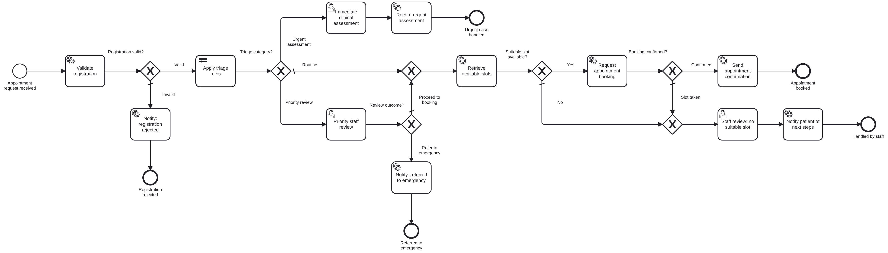

# Lab 3 – Hospital Appointment and Patient Triage Management: Implementation Report

## 1. Objective

Automate a hospital appointment request with Camunda 8: register a synthetic patient, apply predefined educational triage rules (DMN), check appointment availability through a mock scheduling API (REST Connector), route cases to staff in Tasklist when needed, and monitor/recover the workflow in Operate.

## 2. Architecture

| Component | Technology | Responsibility |
|---|---|---|
| Process `hospital-appointment-process` | BPMN on Zeebe 8.8 | orchestration, triage routing |
| Decision `triage-category` | DMN decision table, hit policy FIRST | ROUTINE / PRIORITY_REVIEW / URGENT_ASSESSMENT |
| Worker app `lab3-hospital-triage` (:8093) | Java 17, Spring Boot 3.5, Camunda Spring Boot starter 8.8, Spring `RestClient` | `appointment.validate-registration`, `appointment.request-booking`, `appointment.notify-patient`; deploys models |
| REST Connector | `io.camunda:http-json:1` | `GET /scheduling/api/v1/slots` |
| Mock scheduling API (:8090) | Spring Boot `mock-services` | synthetic calendar, bookings (201/409), outage simulation |
| Tasklist | Camunda user tasks + 3 forms | clinician assessment, priority review, manual scheduling |
| Operate | – | monitoring, incident diagnosis, retry |

## 3. Implementation

**BPMN.** *Appointment request received* (start form) → *Validate registration* → XOR *Registration valid?* → *Apply triage rules* (business rule task) → XOR *Triage category?* with three branches: urgent (user task *Immediate clinical assessment*, candidate group `triage-clinicians`, task priority 100), priority (user task *Priority staff review*, group `triage-nurses`, then XOR *Review outcome?*), routine (default). Routine and approved priority cases merge into *Retrieve available slots* (REST Connector) → XOR *Suitable slot available?* → *Request appointment booking* (worker) → XOR *Booking confirmed?* → *Send appointment confirmation*. No slot or a lost slot (HTTP 409) leads to the user task *Staff review: no suitable slot* (group `front-desk-staff`). Notification tasks share one job type with a `notificationType` input mapping.

**DMN.** Six inputs (chest pain, breathing difficulty, pain score, high fever, age, symptom duration) and eight FIRST-policy rules; red-flag rules first, catch-all ROUTINE last. See [dmn-rules.md](dmn-rules.md).

**Job workers.** [`AppointmentWorkers`](../src/main/java/edu/srmist/camunda/hospital/worker/AppointmentWorkers.java):
* *validate-registration* – [`RegistrationValidator`](../src/main/java/edu/srmist/camunda/hospital/logic/RegistrationValidator.java): synthetic `SYN-PAT-0000` reference only, age 0–120, known department/session, date not past and ≤ 90 days ahead (defaults to tomorrow), symptoms 3–500 chars, pain 0–10; normalises indicators to booleans so the DMN always receives typed values.
* *request-booking* – picks the earliest slot ([`AppointmentLogic`](../src/main/java/edu/srmist/camunda/hospital/logic/AppointmentLogic.java)) and books it via [`SchedulingClient`](../src/main/java/edu/srmist/camunda/hospital/worker/SchedulingClient.java): 201 → CONFIRMED, 409 → SLOT_TAKEN (routed to staff), 5xx/unreachable → retryable job error with 10 s back-off.
* *notify-patient* – simulated SMS text and `finalOutcome`.

**REST integration.** GET with query parameters built from variables (`department`, `appointmentDate`, `preferredSession`); result expression → `availableSlots`, `availableSlotCount`; 3 retries, `PT10S` back-off, then incident. Mock API description and examples: [../api-examples](../api-examples).

**Variables and routing.** [process-variables.md](process-variables.md).

## 4. Test execution and results

| Required scenario | Scenario | Expected |
|---|---|---|
| routine request with an available slot | 01 | BOOKED |
| routed for priority staff review | 02 | review → proceed → BOOKED |
| urgent assessment → immediate human assessment | 03 | URGENT_ASSESSMENT |
| no appointment slots available | 04 (dermatology) | staff task → WAITLISTED |
| scheduling API fails and is recovered | 05 | incident → service UP → retry → BOOKED |

Plus 06 – invalid registration (real-looking name, past date) → REJECTED_INVALID. Actual results come from `GET /api/scenarios/results.md`; executed table and evidence: [test-cases.md](test-cases.md), [screenshots/](screenshots).

Static verification: BPMN lint with camunda-compat 8.8 (0 findings); DMN 12/12 sample cases; four forms schema-valid; 5 JUnit tests for registration, dates, slot selection and outcomes.

## 5. Monitoring and incident recovery

1. `PUT /admin/faults/scheduling?mode=DOWN` – the scheduling mock returns HTTP 503.
2. Scenario 05 reaches *Retrieve available slots*; after 3 attempts (10 s apart) Operate shows an **incident** with the 503 message (`15-operate-scheduling-incident.png`).
3. Diagnosis: the incident message identifies the scheduling endpoint and status; the request itself is valid (`registrationValid = true`, `triage.category = ROUTINE`).
4. Correction: `PUT /admin/faults/scheduling?mode=UP`.
5. **Retry** → slots retrieved → booking confirmed → `finalOutcome = BOOKED` (`16-operate-incident-resolved.png`).

## 6. Assumptions

* Patients, clinicians and slots are synthetic; patient references must match `SYN-PAT-0000`.
* Triage rules are a simplified classroom model; urgent cases are handled by a simulated human assessment, not by the scheduling path.
* Calendar: 30-minute slots 09:00–11:30 and 14:00–15:30 for every department; DERMATOLOGY is fully booked to produce the no-slot case.
* Notifications are simulated.

## 7. Limitations

* No timer escalation if a priority review or urgent assessment is not picked up within its target time (a timer boundary event would add this).
* Booked slots are held in memory by the mock service.
* The booking worker takes the earliest slot; patient choice of slot is not modelled.
* No authentication between worker and Camunda (Camunda 8 Run default); a real deployment would also need audit and data-protection controls.
