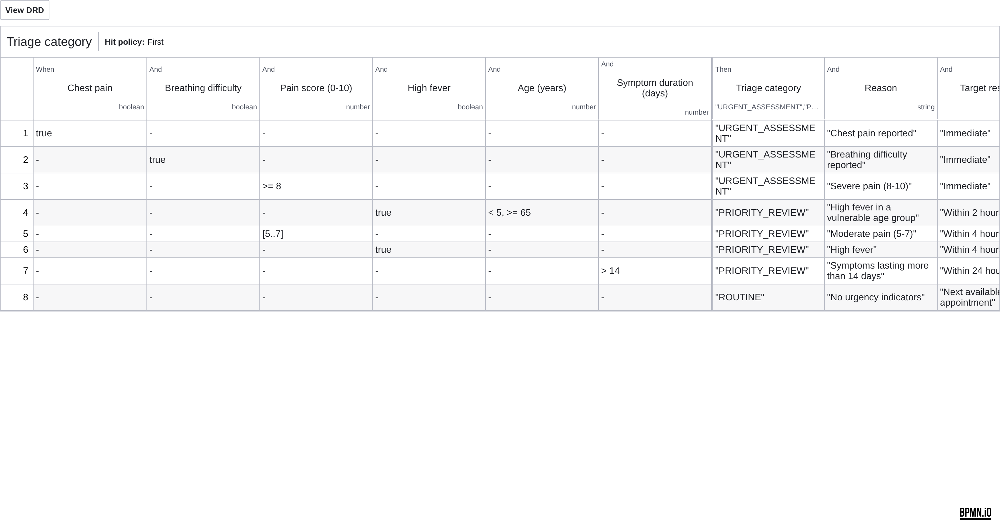

# Lab 3 – DMN decision table `triage-category`

File: [../models/triage-category.dmn](../models/triage-category.dmn). Called by *Apply triage rules*; result stored in `triage`.

> **Educational rules for a simulated workflow – not clinical guidance.**

## Inputs and outputs

| | Label | Expression / name | Type |
|---|---|---|---|
| Input | Chest pain | `chestPain` | boolean |
| Input | Breathing difficulty | `breathingDifficulty` | boolean |
| Input | Pain score (0–10) | `painScore` | number |
| Input | High fever | `highFever` | boolean |
| Input | Age (years) | `ageYears` | number |
| Input | Symptom duration (days) | `symptomDurationDays` | number |
| Output | Triage category | `category` | URGENT_ASSESSMENT, PRIORITY_REVIEW, ROUTINE |
| Output | Reason | `reason` | string |
| Output | Target response | `targetResponse` | string |

## Rules (hit policy FIRST – red flags first, catch-all last)

| # | Condition | Category | Target response |
|---|---|---|---|
| 1 | chest pain | URGENT_ASSESSMENT | Immediate |
| 2 | breathing difficulty | URGENT_ASSESSMENT | Immediate |
| 3 | pain score ≥ 8 | URGENT_ASSESSMENT | Immediate |
| 4 | high fever **and** age < 5 or ≥ 65 | PRIORITY_REVIEW | Within 2 hours |
| 5 | pain score 5–7 | PRIORITY_REVIEW | Within 4 hours |
| 6 | high fever | PRIORITY_REVIEW | Within 4 hours |
| 7 | symptoms > 14 days | PRIORITY_REVIEW | Within 24 hours |
| 8 | otherwise | ROUTINE | Next available appointment |

FIRST guarantees the most severe applicable category wins (a patient with chest pain *and* fever is URGENT, not PRIORITY), and rule 8 guarantees every request gets a category.

## Sample evaluations

Evaluated with a FEEL interpreter against [../models/dmn-tests/triage-category-cases.json](../models/dmn-tests/triage-category-cases.json) – 12/12 as expected (including the pain-7 and 14-day boundaries).

| Case | Chest pain | Breathing difficulty | Pain score (0-10) | High fever | Age (years) | Symptom duration (days) | Matched rule | Triage category | Reason | Target response | Expected | Result |
|---|---|---|---|---|---|---|---|---|---|---|---|---|
| S01 routine, pain 2 | false | false | 2 | false | 34 | 5 | R8 | ROUTINE | No urgency indicators | Next available appointment | ROUTINE | PASS |
| S02 moderate pain 6 | false | false | 6 | false | 52 | 3 | R5 | PRIORITY_REVIEW | Moderate pain (5-7) | Within 4 hours | PRIORITY_REVIEW / Moderate pain (5-7) | PASS |
| S03 chest pain | true | false | 4 | false | 61 | 0 | R1 | URGENT_ASSESSMENT | Chest pain reported | Immediate | URGENT_ASSESSMENT / Immediate | PASS |
| Breathing difficulty | false | true | 1 | false | 30 | 1 | R2 | URGENT_ASSESSMENT | Breathing difficulty reported | Immediate | URGENT_ASSESSMENT | PASS |
| Pain 8 | false | false | 8 | false | 30 | 1 | R3 | URGENT_ASSESSMENT | Severe pain (8-10) | Immediate | URGENT_ASSESSMENT / Severe pain (8-10) | PASS |
| Fever, child aged 3 | false | false | 2 | true | 3 | 2 | R4 | PRIORITY_REVIEW | High fever in a vulnerable age group | Within 2 hours | PRIORITY_REVIEW / Within 2 hours | PASS |
| Fever, adult aged 30 | false | false | 2 | true | 30 | 2 | R6 | PRIORITY_REVIEW | High fever | Within 4 hours | PRIORITY_REVIEW / High fever | PASS |
| Symptoms 20 days | false | false | 3 | false | 45 | 20 | R7 | PRIORITY_REVIEW | Symptoms lasting more than 14 days | Within 24 hours | PRIORITY_REVIEW / Within 24 hours | PASS |
| S04 dermatology routine | false | false | 1 | false | 27 | 10 | R8 | ROUTINE | No urgency indicators | Next available appointment | ROUTINE | PASS |
| S05 paediatric routine | false | false | 3 | false | 6 | 2 | R8 | ROUTINE | No urgency indicators | Next available appointment | ROUTINE | PASS |
| Boundary pain 7 | false | false | 7 | false | 40 | 1 | R5 | PRIORITY_REVIEW | Moderate pain (5-7) | Within 4 hours | PRIORITY_REVIEW | PASS |
| Boundary 14 days | false | false | 4 | false | 40 | 14 | R8 | ROUTINE | No urgency indicators | Next available appointment | ROUTINE | PASS |
